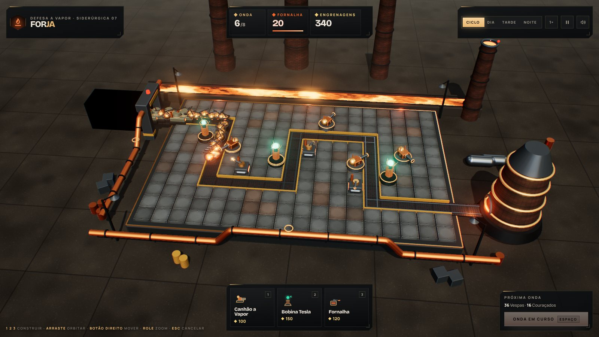
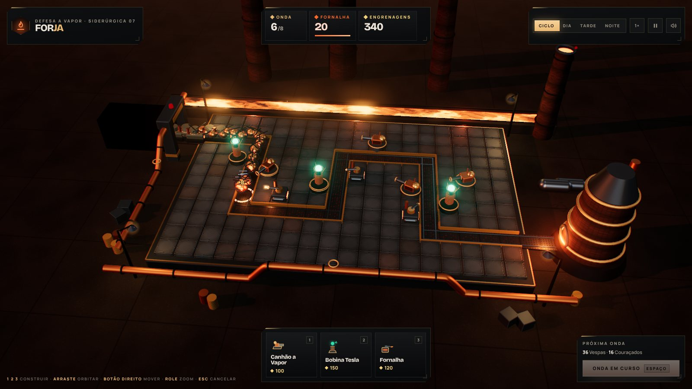
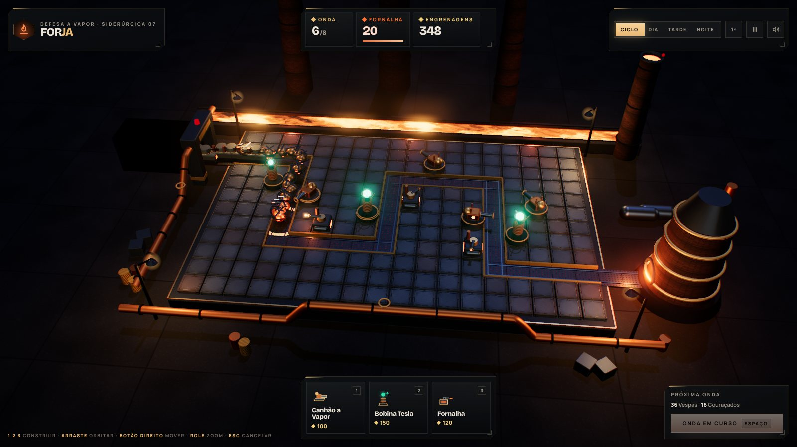
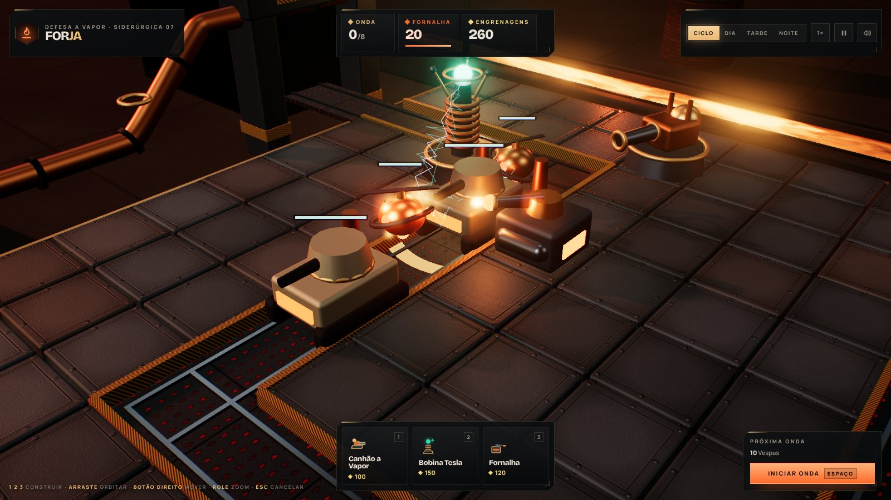
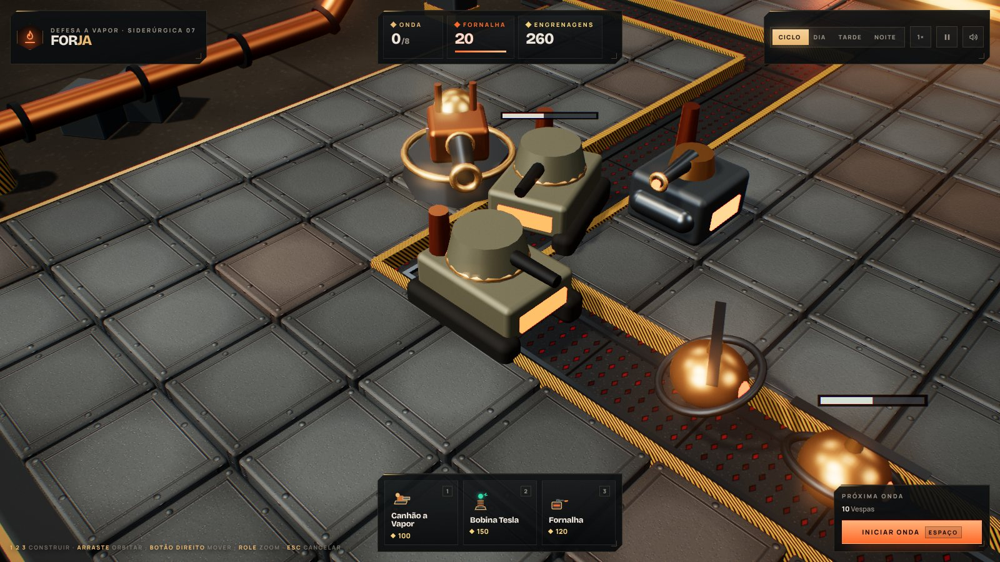

# Forja — Defesa a Vapor

Tower defense 3D em Three.js (r160), sem build e sem assets externos: toda geometria, textura e som é procedural.
Esta é uma **vertical slice**: 1 mapa, 3 torres, 2 inimigos, 8 ondas, ciclo dia/noite e HUD completa.

| Dia | Tarde | Noite |
|---|---|---|
|  |  |  |

| Efeitos (Tesla, chama, dano) | Modelos |
|---|---|
|  |  |

## Rodar

```bash
npm start            # serve a pasta em http://localhost:5173
```
Qualquer servidor estático funciona (o `index.html` carrega o Three do unpkg via importmap).
Abrir o arquivo direto (`file://`) não funciona por causa dos módulos ES.

## Controles

| Ação | Entrada |
|---|---|
| Escolher torre | `1` Canhão · `2` Tesla · `3` Fornalha (ou clique nos cards) |
| Construir / selecionar | clique curto numa placa |
| Melhorar / vender | `U` / `Del` com a torre selecionada |
| Iniciar onda | `Espaço` |
| Câmera | arrastar orbita · botão direito move · roda aproxima |
| Hora do dia | `T` (Ciclo, Dia, Tarde, Noite) |
| Velocidade / pausa / som | `F` / `P` / `M` |

## Arquitetura

```
index.html        HUD (DOM) + CSS + importmap
src/config.js     paleta, balanceamento, layout do mapa e ondas: o único lugar para ajustar números
src/world.js      renderer, câmera, céu em shader, ciclo dia/noite por keyframes, bloom + vinheta + ACES
src/materials.js  materiais compartilhados (nenhum clone), registro de IBL e de brilho noturno
src/textures.js   texturas em canvas: placa rebitada, grade, listra de perigo, concreto, tijolo
src/map.js        tabuleiro instanciado, esteira, calha de lava, chaminés, alto-forno; cenário estático mesclado
src/fx.js         partículas simuladas na GPU, raios, anéis, clarões (pool de PointLights), fuligem
src/enemies.js    inimigos: uma InstancedMesh por peça; barras de vida em billboard no shader
src/towers.js     torres: peças estáticas mescladas por material, projéteis instanciados
src/audio.js      Web Audio procedural
src/main.js       estado, regras, entrada, loop com simulação em passo fixo (60 Hz)
```

Decisões que importam para escalar:
- **Simulação em passo fixo** separada do render: 2× e 3× de velocidade não mudam o resultado do jogo.
- **Partículas na GPU**: a CPU só grava o nascimento (posição, velocidade, vida); a trajetória é calculada no vertex shader, com buffer circular de tamanho fixo e upload parcial.
- **Sem alocação durante o jogo** nos caminhos quentes: pools para partículas, raios, anéis, clarões, fuligem e textos.
- **Bloom com limiar 1.7**: só emissivos HDR (cores > 1) brilham, não reflexos em metal.

## Medições (cenário `?stress=150`: 150 inimigos e 16 torres atirando)

| Métrica | Valor | Observação |
|---|---|---|
| Simulação | ~0,1–0,2 ms por passo | CPU; vale para qualquer máquina |
| Draw calls | 291 por quadro (incluindo sombra e bloom) | eram 532 antes da mesclagem |
| Triângulos | ~500 mil por quadro (incluindo passe de sombra) | |
| FPS | **não medido em GPU real** | o ambiente de teste usa SwiftShader (WebGL na CPU), que deu 13–16 fps em 720p; serve só como limite inferior |

## Testes visuais automatizados

```bash
npm install
node tools/shot.mjs noite.png "shot&manual&tod=0.7" "__td.build('tesla',2,3); __td.state.wave=3; __td.startWave(); __td.advance(240)"
NOSHOT=1 node tools/shot.mjs x.png "stress=150" "" 20000   # só mede window.__perf
```
Parâmetros de URL: `?manual` (loop controlado por `__td.advance(n, dt)`), `?shot` (sem intro), `?tod=0..1` (hora fixa), `?stress=N`, `?debug` (painel de FPS).
`window.__td` expõe `build`, `startWave`, `select`, `setTime`, `camera` e `advance` para montar cenários.

## Pendências conhecidas

- **Torres não são instanciadas.** São a maior fonte de draw calls restante (~7 por torre, mais a sombra). O próximo passo é aplicar o mesmo esquema dos inimigos.
- Os anéis de latão do alto-forno ainda pegam bloom pela luz da boca.
- O túnel de entrada é uma caixa preta simples.
- O upgrade só se vê nos anéis de nível; o modelo da torre não muda.
- O desempenho em celular não foi medido.
